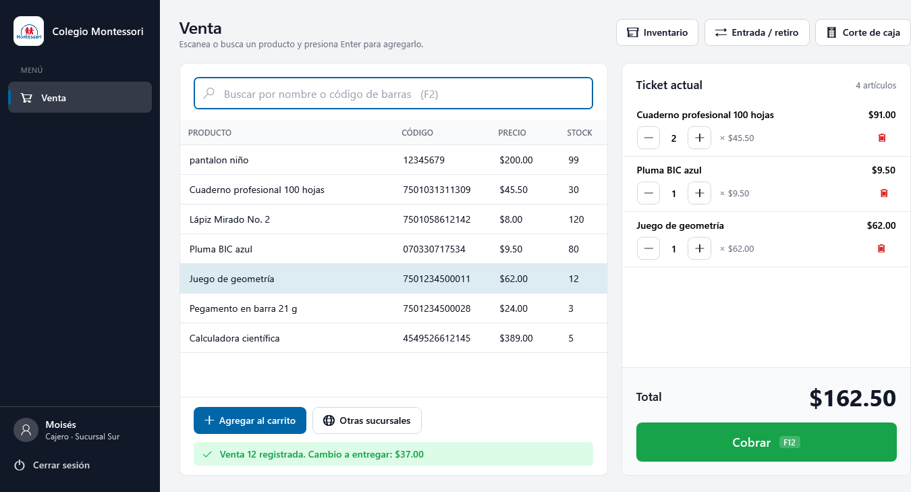

# Punto de Venta (escritorio)

Punto de venta para Windows: ventas con lector de código de barras, turnos y corte de caja, movimientos de efectivo, inventario por sucursal y administración de productos y usuarios. Cada negocio configura su nombre, logo y color en el primer arranque.



## Requisitos para desarrollar

- .NET 8 SDK (o posterior) y Windows.
- Visual Studio 2022 con la carga ".NET desktop development", o la línea de comandos.

## Ejecutar

```bash
cd POS.Escritorio
dotnet run --project src/POS.UI
```

La base de datos se crea sola en `%LocalAppData%\PuntoDeVenta\pos.db`. En el primer arranque aparece el asistente de configuración del negocio; después entra con `admin` / `admin` (pide cambiar la contraseña).

## Publicar para un cliente

```bash
dotnet publish src/POS.UI -p:PublishProfile=Cliente
```

Genera `publicacion/PuntoDeVenta/` con un ejecutable autocontenido. Detalles en [docs/instalacion.md](docs/instalacion.md).

## Documentación

Todo lo demás está en [`docs/`](docs/README.md):

- [Reglas de negocio](docs/reglas-de-negocio.md)
- [Arquitectura](docs/arquitectura.md)
- [Guía de estilo de la interfaz](docs/guia-de-estilo-ui.md)
- [Instalación en un cliente](docs/instalacion.md)
- [Hoja de ruta](docs/hoja-de-ruta.md)
- [Decisiones de arquitectura](docs/decisiones/README.md)
