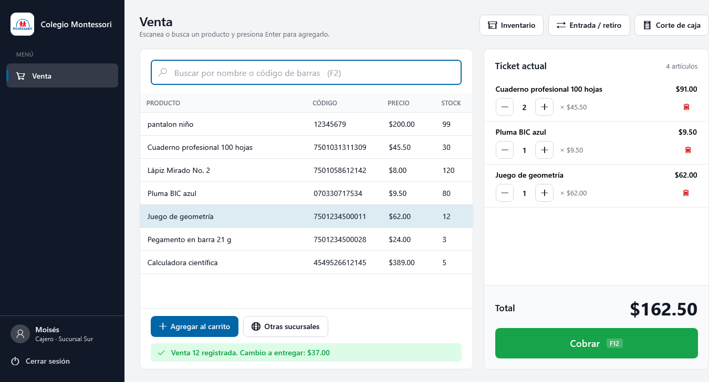
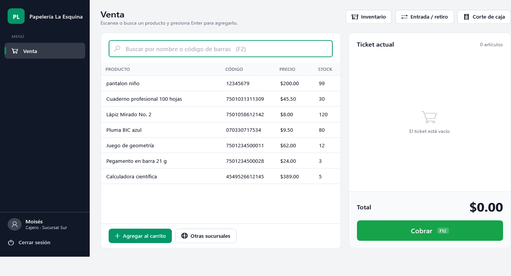
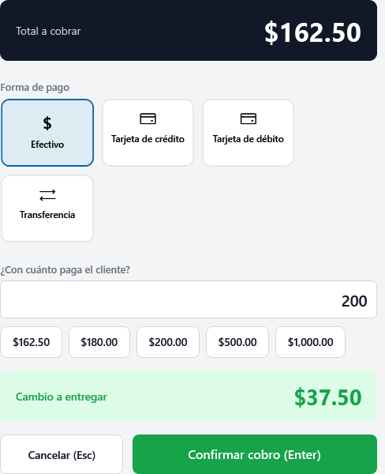
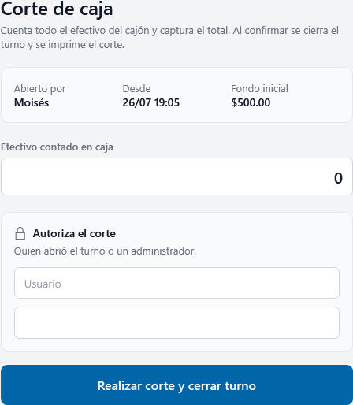
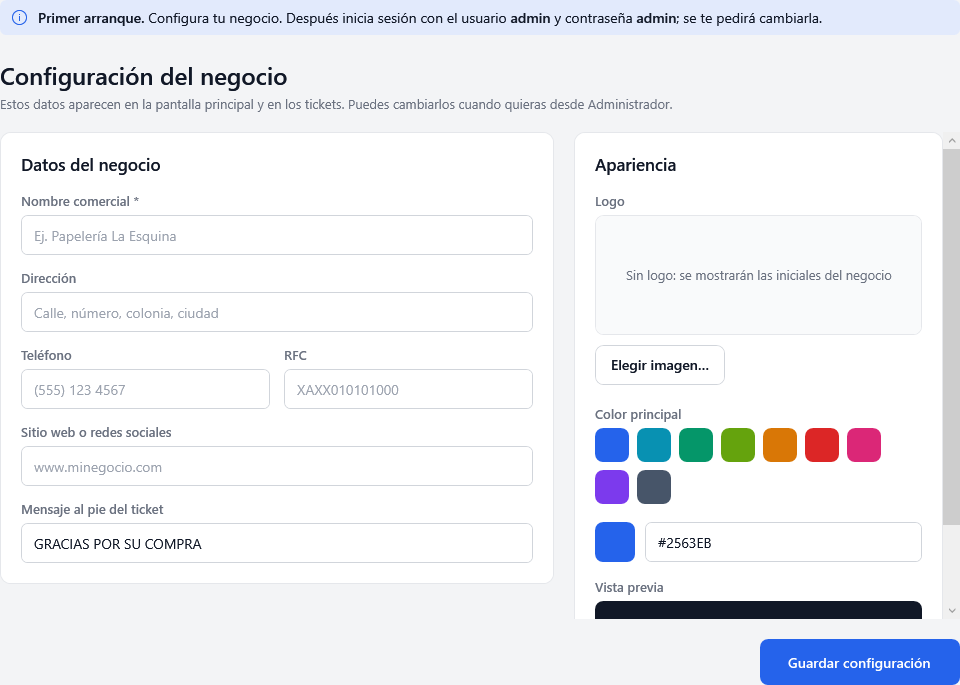

# Documentación del Punto de Venta

Esta carpeta es la **fuente de verdad** del proyecto: qué hace el sistema, por qué lo hace así y cómo se construye. Si el código y estos documentos no coinciden, uno de los dos tiene un error y hay que corregirlo.

| Documento | Para qué sirve | Quién lo usa |
|---|---|---|
| [reglas-de-negocio.md](reglas-de-negocio.md) | Todas las reglas del negocio numeradas (`RN-…`): ventas, turnos, corte, inventario, usuarios. | Todos. Antes de cambiar cualquier comportamiento. |
| [arquitectura.md](arquitectura.md) | Capas, flujo de arranque, patrones y cómo agregar pantallas, servicios o migraciones. | Desarrolladores. |
| [guia-de-estilo-ui.md](guia-de-estilo-ui.md) | Sistema de diseño: colores, componentes, íconos, atajos y textos. | Quien toque cualquier pantalla. |
| [instalacion.md](instalacion.md) | Cómo publicar, instalar en un cliente, respaldar y actualizar. | Quien entrega el sistema al cliente. |
| [hoja-de-ruta.md](hoja-de-ruta.md) | Qué está hecho y qué falta para venderlo. | Planeación. |
| [decisiones/](decisiones/) | Registro de decisiones de arquitectura (ADR): qué se decidió, por qué y qué se descartó. | Antes de "deshacer" algo que parece raro. |

## Capturas

| Venta (marca con logo) | Venta (otra marca, sin logo) |
|---|---|
|  |  |

| Cobro | Corte de caja | Primer arranque |
|---|---|---|
|  |  |  |

El mismo programa cambia de nombre, logo y color según el negocio que lo instala (ver [ADR 0003](decisiones/0003-marca-configurable.md)).

## Cómo mantener esta documentación

1. **Una regla nueva o un cambio de regla** se escribe primero en `reglas-de-negocio.md` con su número `RN-…` y después se programa. En el código, el comentario que la implementa cita el número.
2. **Una decisión que alguien podría cuestionar después** (elegir una librería, una restricción, un "no hacemos X") va como un ADR nuevo en `decisiones/`, con el siguiente número.
3. **Un componente visual nuevo** se agrega a `Theme.xaml` y se documenta en `guia-de-estilo-ui.md`. Las pantallas no inventan estilos propios.
4. Los documentos se escriben en español, en Markdown, y se actualizan **en el mismo commit** que el código que describen.
